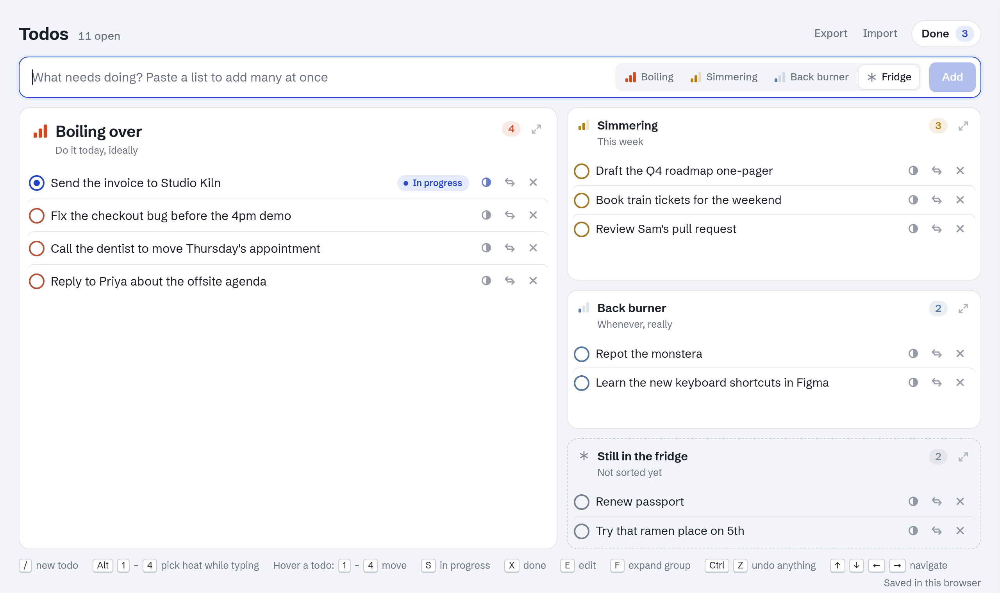

# Todos

**A todo board sorted by heat.** Everything goes into one of four lanes: *Boiling over* (today), *Simmering* (this week), *Back burner* (whenever) or *Still in the fridge* (not sorted yet). Paste a whole list at once, drag things between lanes, and undo anything. Your todos stay in your browser.

**[Open Todos](https://todos.always17.com/)** · no account, no install, works offline

[](https://github.com/NeelkanthTandel/todos/actions/workflows/ci.yml)
[](LICENSE)

<picture>
  <source media="(prefers-color-scheme: dark)" srcset="docs/screenshot-dark.png">
  
</picture>

## Features

- **Four heat lanes.** The hottest lane gets the most room; cooler ones stack beside it. Expand any lane to fill the board.
- **Paste a list.** Bullets, numbers and checkboxes are stripped, `[x]` items land straight in Done, and the whole batch goes to the fridge for sorting.
- **Drag and drop** between and within lanes, or press `1`–`4` on a todo to move it.
- **In progress** marks what you're actually working on.
- **Done** slides out from the side, grouped by day. Ticked todos linger for a moment so you see them go.
- **Undo anything** with `Ctrl/⌘+Z`, redo with `Ctrl/⌘+Shift+Z`: adds, deletes, moves, edits, imports, clearing Done.
- **Keyboard first.** Shortcuts work on the focused todo, or on the one under your mouse.
- **Export as plain text** to paste anywhere (copy or `.txt`), or **export and import** a JSON backup to move between browsers or devices.
- **Clipboard suggestions** (Chrome, Edge, Brave and the Mac app; off until you turn them on). Copy something, come back to Todos, and it's waiting in the box, selected: `Enter` adds it; `Backspace`, `Esc` or typing dismisses it; `Tab` keeps it to edit. Anything that looks like a password, API key, token, database URL with credentials, one-time code or card number is never suggested, and copies older than 10 minutes are ignored. Turn it on or off from the footer.
- **Claude Code sessions as suggestions** (optional). Connect Claude Code and each new session shows up above the board; one key adds it, and the todo follows the session's status. End-to-end encrypted. See [Claude Code integration](#claude-code-integration).
- **Light and dark**, following your system. Works on phones.
- **A Mac app** that opens and hides with `⌥ Space` from anywhere. Under 1 MB. See [Mac app](#mac-app).
- **Private.** No accounts, analytics, trackers or third-party requests. It's a static page; your list never leaves your browser. (The optional Claude Code integration goes through this project's own relay, encrypted end to end.)

## Keyboard shortcuts

| Key | Does |
| --- | --- |
| `/` | Jump to the new-todo box |
| `Enter` / `Shift+Enter` | Add / new line (paste or type several lines to add many) |
| `Alt+1`–`Alt+4` | Pick the lane while typing |
| `1`–`4` | Move the focused or hovered todo to that lane |
| `S` | Mark in progress, or stop |
| `X` | Done, or not done |
| `E` | Edit |
| `Delete` | Delete |
| `F` | Expand the lane under the mouse (`Esc` to go back) |
| `↑` `↓` `←` `→` | Move between todos and lanes |
| `Ctrl/⌘+Z`, `Ctrl/⌘+Shift+Z` | Undo, redo |

On a Claude session suggestion (focused or under the mouse): `Enter` or `1` adds it to Boiling over, `2`–`4` to another lane, `E` edits the title first, `Esc` or `Delete` dismisses it. `A` adds the newest suggestion from anywhere on the board.

## Claude Code integration

Run many Claude Code sessions at once? Each new one can show up on your board as a suggestion, waiting in a **Claude sessions** strip above the lanes. It isn't added until you say so. Once added, the todo shows the session's live status: **running**, **needs you** (waiting on a permission or question), **your turn** (finished its reply) or **ended**, and the tab title counts sessions that need you, like "(2) Todos". This works for Claude Code in the terminal, the desktop app and cloud sessions.

**Set it up** (once per machine):

1. Install the plugin in Claude Code (needs Node 18+):
   ```
   /plugin marketplace add NeelkanthTandel/todos
   /plugin install todos@todos
   ```
2. On the board, click **Connect Claude Code** in the footer and run the `/todos:connect …` command it shows in Claude Code on that machine.

The same dialog lists connected machines, each with a **Disconnect** button. `/todos:disconnect` forgets the connection on a machine. For cloud sessions, which start from a fresh container, set `TODOS_CONNECTION=<code>` in the environment's variables instead.

**What's sent:** for each session, its first prompt's first line as a title (with Markdown and code removed, and nothing at all if it looks like a key, token or password), the project's folder name, and its status changes. Never your code, files, full prompts or paths. Everything is encrypted on your machine with a key that only your board and your connected machines have; the relay in between ([`relay/`](relay/README.md)) stores ciphertext only, and the board deletes each message once it has read it.

**Opt out** per project with a `.todos-ignore` file in its root, or everywhere with `TODOS_DISABLE=1`.

**Using a suggestion:** `Enter` (or the **Add** button) adds it to Boiling over, `2`–`4` to another lane, `E` lets you edit the title first, `Esc` dismisses it, and `A` adds the newest one from anywhere on the board. `Ctrl/⌘+Z` undoes an add. Click a linked todo's status badge to copy `claude --resume <id>`. Suggestions from sessions that ended a day ago without being added disappear on their own.

More detail: [`claude-plugin/README.md`](claude-plugin/README.md).

## Where your todos are stored

By default everything lives in your browser's `localStorage`:

- **Each browser keeps its own list.** Your laptop and phone don't share todos, and nothing reaches a server. Use **Export** and **Import** to copy a list across.
- **Clearing site data deletes it**, and Safari deletes it if you haven't opened the site for 7 days (unless you've added it to your Home Screen). Export a backup now and then.
- **Tabs stay in step.** A change in one tab shows up in your other tabs straight away.

### Export / Import

**Export** (top right) opens a menu:

- **Copy as text** / **Download as text (.txt)**: a plain list, one numbered group per lane (`p1` Boiling over, `p2` Simmering, `p3` Back burner, `p4` Fridge). Done todos come last in their group, struck through. Empty lanes are skipped.

  ```text
  p1

  1. Fix the checkout bug
  2. Reply to Priya
  3. P̶a̶y̶ ̶r̶e̶n̶t̶


  p2

  1. Draft the Q4 roadmap
  2. Book train tickets
  ```

- **Download backup (.json)**: everything, for Import. Saved as `todos-YYYY-MM-DD.json`:

```json
{ "app": "todos", "version": 1, "exported": "2026-10-22T09:30:00.000Z", "items": [ ... ] }
```

**Import** reads that file, or a bare array of todos, and merges by `id`. A todo in the file replaces the same todo on the board, and everything else is kept. One `Ctrl/⌘+Z` undoes the whole import. Files over 2 MB or 5,000 todos are refused.

## Mac app

The same board as a Mac app, under 1 MB, with one extra: **`⌥ Space` (Option+Space) shows and hides it from anywhere.** It looks and works exactly like the website, because it is the website: a small Swift shell around the files in `public/`. macOS 14 or later, Apple Silicon or Intel.

**Install**

1. Download **Todos.dmg** from the [latest Mac release](https://github.com/NeelkanthTandel/todos/releases), open it and drag **Todos** to **Applications**.
2. The app isn't notarized by Apple yet, so macOS blocks it the first time. Open Todos, and when macOS says it can't verify the app, click **Done**. Then open **System Settings › Privacy & Security**, scroll to **Security**, click **Open Anyway** next to Todos, confirm with your password or Touch ID, and click **Open**. You only do this once. Prefer the Terminal? `xattr -dr com.apple.quarantine /Applications/Todos.app`

**Using it**

- **`⌥ Space`** brings the board forward from any app; press it again to hide it and go back to what you were doing. Todos takes over Option+Space system-wide while it runs, so another app using that shortcut (some launchers, or a keyboard layout's non-breaking space) won't get it. Quit Todos (`⌘Q`) to give it back.
- Closing the window (`⌘W`) only hides it. Todos keeps running so the shortcut keeps working; click its Dock icon or press `⌥ Space` to bring it back.
- **Clipboard suggestions** work in the app too, and it never reads copies a password manager marks as concealed.
- Export saves wherever you choose; Import opens a file picker. Links open in your browser.

**Your list in the app is separate** from the one in your browser: each keeps its own. To have one list everywhere, link them with **device sync** once it's available, or move it once with Export and Import.

**Build it yourself** (needs Xcode 16 or later): `cd mac && make app` builds `mac/build/Todos.app`, `make test` runs the tests, and `make dmg` makes the disk image. Pushing a `mac-v1.2.3` tag publishes a release. Details: [`docs/plans/04-mac-app.md`](docs/plans/04-mac-app.md).

## Run it yourself

It's plain HTML, CSS and JavaScript with no build step, so any static file server works:

```bash
git clone https://github.com/NeelkanthTandel/todos.git
cd todos
python3 -m http.server 8080 -d public
```

Then open http://localhost:8080.

### Host your own copy

`public/` is the whole site, so any static host works: publish that folder, with no build command.

On GitHub Pages, `.github/workflows/pages.yml` already publishes `public/` whenever it changes on `main`. In a fork, set **Settings → Pages → Source** to **GitHub Actions**.

Give it its own domain or subdomain if you can. Every project page under `you.github.io` shares one `localStorage`, so another page there could read your todos. Keys are prefixed with `namespace` from `public/config.js` to avoid collisions, but that doesn't keep the data private.

## Running your own relay

The Claude Code integration needs the relay in [`relay/`](relay/README.md), a Cloudflare Worker that fits the free plan. `.github/workflows/relay.yml` deploys it from `main` once the `CLOUDFLARE_API_TOKEN` and `CLOUDFLARE_ACCOUNT_ID` repo secrets are set. Then set `relayBase` in `public/config.js` to its address and add its `https://` and `wss://` origins to `connect-src` in `public/index.html`. With `relayBase` empty, the integration stays hidden.

## Moving to a database later

The app never talks to a database directly. It always keeps the `localStorage` copy, so it loads instantly and works offline. Set `storage: "http"` in `public/config.js` and it also mirrors the whole list to an API with this contract (full details at the top of [`public/storage.js`](public/storage.js)):

| Method | Path | Body / response |
| --- | --- | --- |
| GET | `/api/todos` | `200 { items, updated }`, or `404` if nothing is stored yet |
| PUT | `/api/todos` | body `{ items, updated }`, reply any `2xx` |

- **The server works out who the user is** from its own session or cookie, so the client never sends a user id.
- **Postgres:** `create table todo_lists (user_id text primary key, items jsonb not null, updated bigint not null);`. GET selects the row, PUT upserts it.
- **Mongo:** one document per user, `{ _id: userId, items: [...], updated }`, written with `replaceOne(..., { upsert: true })`.
- **Existing browser data moves over automatically.** On first connect, if the server answers `404` (or an empty list with `updated: 0`) and the browser has todos, the app uploads them. Changes made while offline are uploaded when the server is reachable again.
- **A newer server list wins.** When the tab regains focus, the app fetches the list and takes it if its `updated` is newer than what this browser last saw.
- **Run the API on the same origin as the site** (for example behind the same domain's `/api` path). That avoids CORS and keeps cookies simple. An exported JSON file can seed the table, since `items` has exactly the shape the API stores.

## Contributing

Contributions are welcome! See [CONTRIBUTING.md](CONTRIBUTING.md) for setup, how the code fits together and the test page. Please report security issues privately as described in [SECURITY.md](SECURITY.md).

## License

[MIT](LICENSE). The bundled Schibsted Grotesk font is under the [SIL Open Font License](public/fonts/OFL-SchibstedGrotesk.txt).
